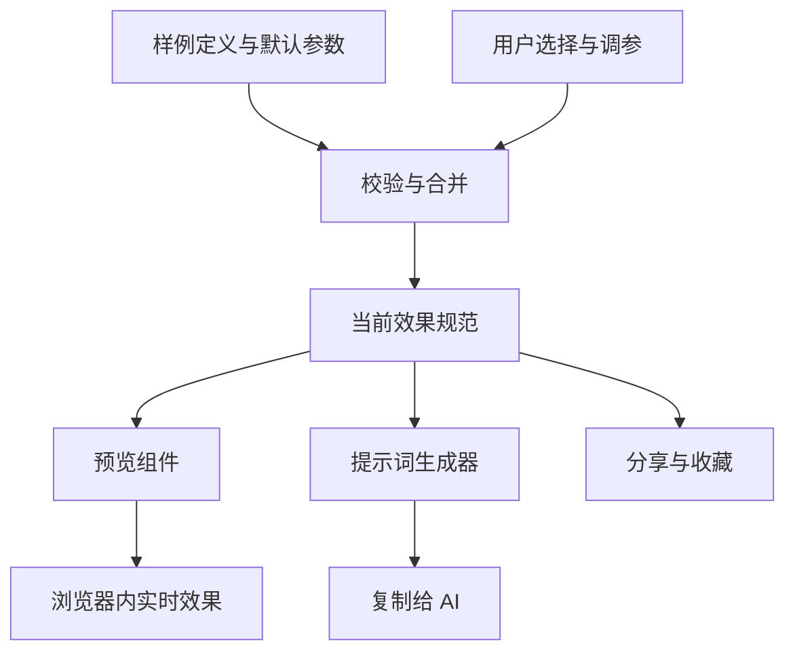

# UI 效果库架构与技术选型方案

日期：2026 年 10 月 26 日。目标用户：海外或全球用户，包括通过 AI 制作页面、但不熟悉设计术语的人。

文档状态：技术与实施方案。基础工程已初始化，详细功能仍待实现；已确认的产品需求与约束见 [PRODUCT.md](/Users/peipei/mine/wanwan-Workspace/tomoyo-design/PRODUCT.md)。

建议采用 **Next.js App Router + React + TypeScript + Tailwind CSS + Motion**，以结构化内容文件管理样例，通过 Vercel 发布。首版采用静态页面和浏览器内交互，提供效果浏览、参数调整、提示词复制和有限范围的效果组合。

项目采用根目录组织：`app/`、`components/`、`features/` 等直接放在项目根目录，不设置 `src/`。实施顺序为 **产品设计语言与核心页面 → 网站布局和交互 → 效果运行与提示词 → 内容扩充**。

页面结构、竞品依据和网站自身的动效规范见 [页面与交互方案](/Users/peipei/mine/wanwan-Workspace/tomoyo-design/docs/experience-design.md)。工程实现以该文档确定的页面职责为依据。

系统最重要的约束是：**实际预览、复制的提示词和分享的参数，必须来自同一份效果规范。** 内容更新时，这三者一起更新。

## 1 产品目标与首版范围

用户可以从视觉示例出发，认识效果、调整效果，再将准确的描述交给自己的 AI 工具实现。

首版的主要流程：

**浏览样例 → 体验交互 → 调整参数 → 复制提示词 → 在自己的项目中复现。**

| 能力 | 首版方案 |
|---|---|
| 浏览效果 | 按类别、标签、名称和中英文别名查找 |
| 体验效果 | 支持悬停、点击、滚动、重播，以及适用的触屏操作 |
| 调整参数 | 每个样例提供少量有意义的参数，例如距离、时长、圆角、透明度 |
| 复制提示词 | 中英文切换，参数变化后实时更新，可选择通用描述或 React 实现要求 |
| 组合效果 | 在受支持的场景模板中组合风格、配色、材质、布局和动效 |
| 保存与分享 | 本机收藏，分享链接保留样例版本与参数 |
| 国际化 | 首批内容和主要操作提供中文、英文，界面语言与提示词语言分别选择 |

首版由维护者制作和发布样例，用户免登录即可使用核心功能。用户投稿、跨设备同步、付费内容和站内 AI 生成，按实际需求在后续阶段接入。

## 2 页面与信息架构

网站自身保持稳定、清楚的导航和控件风格，不同视觉风格在预览区域内展示。用户切换样例时，操作位置和使用方式保持一致。

| 页面 | 核心职责 | 建议路由 |
|---|---|---|
| 首页 | 说明产品价值，以一个可操作的场景演示“选效果、看变化、复制提示词” | `/en`、`/zh` |
| 效果库 | 搜索、分类、筛选和比较独立效果；搜索结果仍在本页 | `/en/explore` |
| 效果详情 | 理解、体验和调整一个效果，复制对应提示词 | `/en/effects/[slug]` |
| 场景配方列表 | 按用途查找已经搭配好的完整场景 | `/en/recipes` |
| 场景配方详情 | 体验整个场景、理解效果组合、复制完整提示词或进入工作台修改 | `/en/recipes/[slug]` |
| 工作台 | 选模板、组合兼容效果、调参，输出当前组合的提示词 | `/en/builder` |
| 本机收藏 | 找回收藏的效果、配方和本机保存的组合 | `/en/saved` |
| 使用指南 | 解释提示词用法、复现方法和容易混淆的术语 | `/en/guide` |
| 独立预览 | 供 iframe 加载的可信效果画布，无主站导航、不进入搜索引擎索引 | `/preview/[id]` |
| 设计规范页 | 在开发与评审中检查颜色、字体、控件、布局和动效状态，无主导航入口、不进入搜索引擎索引 | `/design-system` |

`/zh` 使用相同的信息结构。域名根路径 `/` 由托管层固定跳转到 `/en`，语言切换保留当前内容位置；首版不根据请求位置判断语言。静态导出时将该跳转配置在托管平台，不依赖 Next.js 的请求时重定向。`/design-system` 只包含可公开的界面规范；不出现在导航和索引中不代表访问控制。

顶部主要导航为 **效果库、场景配方、工作台**。Logo 返回首页；搜索、收藏和语言切换为辅助入口。首页采用宽幅内容布局，列表页采用分类栏与网格，详情和工作台采用大预览与操作面板。各类布局共享同一套颜色、字体、间距和控件。

每个详情页生成独立标题、描述和分享预览图，并加入网站地图；中文与英文页面标明对应语言版本。效果库筛选使用无筛选参数的目录地址作为规范地址，自定义效果配置使用对应内容详情页作为规范地址，避免同一内容产生大量重复索引。

桌面详情页采用“预览区 + 参数和提示词面板”，“复制提示词”始终是主要操作。手机上先展示预览，参数与长提示词按需展开，底部保留复制入口。所有效果都可以从详情链接直接访问；从列表返回时恢复搜索、筛选和浏览位置。

## 3 如何把手册变成可维护的内容

手册中的条目适合分成以下内容类型，各类型使用不同的预览方式。

| 内容类型 | 手册对应内容 | 展示方法 |
|---|---|---|
| 动效 Motion | 缩放、翻转、悬停浮起等 | 可触发、可重播的独立演示 |
| 风格 Style | 现代简约、杂志编辑、新粗野主义等 | 使用可比较的内容结构展示完整视觉方向 |
| 配色 Palette | 暖色、奶油色、深色主题等 | 展示色板，并应用到背景、文字、卡片、强调色 |
| 材质 Material | 纸张、磨砂、阴影、颗粒等 | 在相同对象上对比表面效果 |
| 布局 Layout | 卡片、便当盒、非对称等 | 使用相同内容比较排列方式和响应式变化 |
| 节奏 Timing | 缓出、舒缓、短促、弹簧感等 | 作为适用动效的预设，并提供并排比较 |
| 配方 Recipe | 温暖阅读、科技大屏、作品集等 | 引用上述条目，形成有明确参数的场景 |

这里的风格是整体预设，材质是可应用到特定对象的属性。例如“玻璃拟态风格”可以引用“磨砂玻璃材质”，两者共享基础定义，避免维护两份互不一致的数据。

第一批建议制作 **24 个独立样例**：10 个动效、4 个风格、4 个材质、3 个布局、3 个配色，另配 4 组节奏预设和 3 个场景配方。内容数量是首版范围建议，可按制作质量调整。

## 4 技术栈与取舍

| 层级 | 推荐选择 | 在本项目中的用途 |
|---|---|---|
| 应用框架 | Next.js App Router + React + TypeScript | 目录和详情页面静态生成，交互区使用 React，保持统一组件体系 |
| 网站样式 | Tailwind CSS + CSS 自定义属性 | 导航、栅格、面板和响应式布局；颜色、间距等通过变量传递 |
| 基础控件 | 按需引入 shadcn/ui | 滑块、开关、弹窗、下拉框；样例的视觉效果由项目自行实现 |
| 动画 | 原生 CSS + Motion for React | CSS 处理简单过渡，Motion 处理弹簧、交错、手势和布局动画 |
| 内容存储 | TypeScript 内容文件 + 静态资源 | 开发者直接维护样例，内容与实现一起版本管理 |
| 参数校验 | Zod | 校验内容、外部分享参数和组合配置 |
| 状态 | React 局部状态与 reducer | 管理当前预览和组合器；URL 表达可分享状态，localStorage 保存本机收藏 |
| 搜索 | 构建时生成的轻量索引 + 客户端匹配 | 搜索中英文名称、别名、标签、简述；首批几十个样例可直接匹配 |
| 测试 | Vitest + Playwright | 校验提示词和参数逻辑，验证实际浏览、调参、复制和分享流程 |
| 部署 | Vercel + Git 仓库 | 分发静态资源，提供发布和预览环境 |
| 包管理 | pnpm | 固定依赖和锁文件，保持本地与构建环境一致 |

Next.js 支持将页面导出为静态文件，也允许后续改为需要服务端的部署方式。这符合首版内容驱动、后续可能加入账号的方向。[Next.js 静态导出文档](https://nextjs.org/docs/app/guides/static-exports)

交互边界限定在预览、调参和组合器中；页面说明和内容目录优先在构建时生成。[Next.js 组件边界文档](https://nextjs.org/docs/app/getting-started/server-and-client-components)

Motion 支持 React 中的弹簧、布局、手势和滚动动画；项目安装 `motion`，从 `motion/react` 引用。简单的颜色或透明度过渡使用 CSS 即可。[Motion for React 文档](https://motion.dev/docs/react)

shadcn/ui 提供可以直接修改的组件代码，适合调整操作面板的样式。[shadcn/ui 文档](https://ui.shadcn.com/docs) 动态参数通过 CSS 变量或内联样式传递，Tailwind 类名保持静态可发现，避免运行时拼接任意类名。[Tailwind 样式文档](https://tailwindcss.com/docs/styling-with-utility-classes)

Zod 用于将内容规则落实为可执行校验，TypeScript 则帮助开发时发现类型问题。[Zod 文档](https://zod.dev/)

### 其他框架的适用条件

| 方案 | 适合的情况 | 本项目的取舍 |
|---|---|---|
| Next.js + React | 内容页面与交互工具同时存在，未来可能增加服务端功能 | 推荐。需要明确客户端组件边界，并遵守静态导出限制 |
| Astro + React | 内容阅读为主，交互集中在独立区域 | 同样可行。如果后续长期以百科展示为主，可以优先选它 |
| Vite + React | 以单个交互应用或内部工具为主 | 原型很直接；公开目录的路由、页面预渲染和元信息需要另行组合 |

Astro 的 islands 机制适合为静态页面中的局部区域添加交互。[Astro 文档](https://docs.astro.build/en/concepts/islands/) Vite 可以构建静态站点，也支持进一步配置服务端渲染。[Vite 部署文档](https://vite.dev/guide/static-deploy)

选择 Next.js 的主要依据是本产品同时包含公开目录、参数工具和未来的组合保存能力；这是针对当前产品方向的工程判断。

依赖在项目初始化时选择相互兼容的稳定版本并提交锁文件。方案不依赖某个尚未验证的最新小版本功能。

## 5 系统模块与数据流

采用单仓库、单应用，在内部按职责划分模块：

| 模块 | 职责 |
|---|---|
| Design System / App Shell | 维护网站自身的视觉变量、动效参数、控件状态，以及首页、列表、工作台布局 |
| Catalog | 分类、检索、元信息、相关条目 |
| Effect Registry | 维护样例定义、版本、参数规则，以及对应预览组件的映射 |
| Spec Resolver | 合并默认值与用户修改，校验参数和组合，得到当前效果规范 |
| Preview Runtime | 将效果规范交给已实现的组件，控制触发、重播、暂停和视口 |
| Prompt Builder | 将同一份规范转为指定语言和目标技术要求的提示词 |
| Recipe Builder | 选择场景和各类效果，提供兼容范围内的组合 |
| Persistence | 编码分享链接、保存本机收藏、恢复旧版配置 |



预览组件和提示词生成器共同读取最终规范，各自的内部默认值不再覆盖这份规范。这样修改“上浮距离 6px”为“10px”时，预览、提示词和分享链接中的值同时改变。

首版所有模块都可以在构建过程或浏览器中运行，无需专门的业务 API。

## 6 样例的数据结构

每个样例至少记录以下信息：

| 字段 | 用途 |
|---|---|
| id / revision | 稳定标识与内容版本，供收藏和分享引用 |
| kind / tags / aliases | 类型、分类和搜索别名 |
| title / description | 中英文名称与说明 |
| previewKey | 对应预览组件的标识 |
| parameterSchema / defaults | 合法参数、单位、范围、默认值 |
| promptTemplateKey | 对应提示词模板及版本 |
| capabilities | 支持的对象、触发方式、场景和参数 |
| fallback | 触屏、减少动态效果、特性不可用时的行为 |
| assets | 预览图、字体、纹理等必要素材及来源信息 |

数据定义与 React 组件分开存放。搜索列表只读取元信息，访问样例时才加载对应组件。

例如，下面是悬停浮起样例在合并参数后的规范示意：

```json
{
  "schemaVersion": 1,
  "effectId": "hover-lift",
  "effectRevision": 1,
  "target": "card",
  "trigger": "hover-or-focus",
  "liftPx": 6,
  "transition": {
    "type": "tween",
    "durationMs": 200,
    "easing": [0.16, 1, 0.3, 1]
  },
  "shadow": {
    "idle": "0 4px 12px rgba(0,0,0,0.08)",
    "active": "0 12px 28px rgba(0,0,0,0.14)"
  },
  "reducedMotion": "shadow-only"
}
```

参数统一使用明确单位，例如距离使用 px，时间使用 ms；Motion 适配层负责转换为其需要的时间单位。弹簧动画使用独立参数类型，记录 stiffness、damping、mass，界面只显示该模式实际生效的参数。

`schemaVersion` 表达数据格式版本，`revision` 表达样例内容版本。旧分享链接遇到不兼容变更时，需要迁移或明确提示，避免用户在不知情的情况下看到不同效果。

## 7 预览系统

列表页优先显示静态预览图。用户悬停、聚焦或点击体验时，只激活当前样例，避免整页同时运行大量动画。

详情页和场景模板在独立 iframe 中运行，隔离全局样式，并让切换预览宽度能够触发真实的响应式布局。预览路由与网站操作面板使用独立样式入口，避免网站主题影响样例。

父页面通过明确的消息格式向预览发送规范和重播指令；预览准备完成后回传状态。消息校验来源窗口、来源域和数据格式。iframe 在首版承载维护者编写的可信组件，主要用于样式与视口隔离。

每个预览实现统一的能力接口：接收参数、重播、暂停、重置、切换视口，并声明是否支持滚动或指针跟随。

不同效果使用合适的展示场景：

- 滚动渐显和视差使用可滚动的真实内容，并提供明显的滚动引导。
- 布局样例使用相同数据，分别展示宽屏、窄屏的排列方式。
- 材质样例保留能看出效果的背景，例如磨砂玻璃后方需要有可观察的内容。
- 风格样例包含标题、正文、按钮和卡片，保证用户能看到完整的设计语言。

翻书动画与卡片翻转作为不同样例实现。真实纸张弯曲、复杂流体和高密度粒子效果放在后续专题，根据需要单独引入专用实现，并按需加载。

## 8 提示词生成与复现质量

首版采用本地模板生成。用户改变参数后立即得到新提示词，不产生模型请求，也无需等待模型回复。

提示词按照以下顺序生成：

**目标对象或页面 → 风格与视觉参数 → 触发条件与状态变化 → 时长或弹簧参数 → 响应式行为 → 减少动态效果的处理 → 用户指定的技术约束。**

针对前述样例，中文提示词可以表达为：

> 为可交互卡片实现悬停浮起效果。鼠标悬停或键盘聚焦时，卡片向上移动 6px，阴影从 0 4px 12px rgba(0,0,0,0.08) 过渡到 0 12px 28px rgba(0,0,0,0.14)。过渡时长 200ms，曲线使用 cubic-bezier(0.16,1,0.3,1)。离开或失焦后按相同参数恢复。用户开启减少动态效果时保留阴影反馈，取消位移。

默认导出采用通用 Web 描述，目标技术默认“沿用现有项目”。用户主动选择 React 时，再追加 React 实现要求。平台自身使用 React，不应让所有导出的提示词都强制要求用户改用 React。

提示词面板提供两个层级：便于理解的完整自然语言描述，以及可展开的结构化参数。分享链接包含样例标识、版本和实际参数，方便定位同一个参考。

复现质量的目标是关键视觉和交互特征一致。不同 AI 和项目环境仍会产生实现差异；需要更高一致性时，可在后续加入版本化参考代码、截图和素材包导出。

## 9 组合器与冲突处理

组合器先选择场景模板，例如阅读页面、作品集和工具面板，再选择该模板支持的选项。

| 选项 | 首版规则 |
|---|---|
| 主风格 | 一种，提供基础排版、形状和层级 |
| 配色 | 一组，覆盖背景、文字、表面和强调色等语义颜色 |
| 布局 | 一种，在模板支持的布局中切换 |
| 材质 | 按对象选择，例如卡片纸张、面板磨砂 |
| 动效 | 按对象和触发方式配置，例如卡片入场、按钮按压 |
| 节奏 | 应用于支持该模式的动效，并映射到实际参数 |

合并顺序是场景默认值、主风格、配色与材质、用户显式参数。每类选项只修改自己负责的属性。

冲突需要在选择时处理。例如同一面板不能同时使用两种互斥的基础材质；同一触发位置只选择一个主动画；入场和悬停都修改 transform 时，由预览适配器统一合成。发生覆盖时，界面说明被替换的选项。

首版只展示经过验证的模板与组合。某个效果未接入当前模板时，保持其独立详情页可用，组合器不将其列为可用选项。这样组合预览与导出的提示词始终具有明确对应关系。

## 10 搜索 分享与本地保存

首批几十个样例可通过规范化后的字符串匹配完成搜索。索引包括中英文名称、中文别名、英文术语、标签和简述；例如搜索“浮起来”可以匹配“悬停浮起”。出现明显的搜索质量需求后再增加模糊检索，服务端搜索取决于内容规模和实际性能。

分享状态编码到详情或组合器链接的 URL fragment 中，例如保存样例 ID、版本和用户修改过的参数。浏览器打开固定路由后读取 fragment，完成校验并恢复预览。任意配置不会生成新的静态路由。

编码内容设置大小和参数范围限制。非法配置显示恢复默认值的入口；较长的组合可以导出 JSON 文件，短链接留待接入后端时实现。

本机收藏使用 localStorage，提供导入和导出。界面明确标注本机保存；清除浏览器数据或更换设备不会自动保留收藏。存储不可用时，浏览、调参和复制仍然可用。

## 11 内容生产与项目组织

新增样例遵循固定流程：

1. 定义名称、分类、默认参数和适用范围。
2. 实现预览组件，将可调值全部接到效果规范。
3. 编写中英文提示词模板，以及对应的说明和降级行为。
4. 注册组件映射，生成预览图，检查桌面和触屏操作。
5. 通过参数校验与关键流程检查，再发布内容。

### 当前实现的职责边界

2026-10-27 已落地的首页按以下边界组织，所有目录都在根目录，不创建 `src/`：

| 位置 | 负责什么 | 不放什么 |
|---|---|---|
| `app/[locale]/` | 路由参数、元信息、静态生成、语言根布局和页面组装 | 效果交互、整页动效控制器、大段区域样式 |
| `features/home/home-page.tsx` | 组合首页导航、效果体验、使用说明和页脚 | 资源等待、复制状态、动画时序 |
| `features/home/effects/` | 预览舞台、效果选择、分类入口、提示词操作和各自 hooks | 跨页面导航、整页开屏逻辑 |
| `features/home/motion/` | 加载状态编排、资源准备、开屏、内容入场与滚动 | 提示词状态或具体效果参数 |
| `features/home/styles/` | 按区域维护首页样式，响应式规则跟随所属区域 | 公共元素重置、其他页面样式 |
| `features/motion-preview/` | 比较方案的预览工具栏 | 正式首页专属内容 |
| `components/{ui,navigation,motion}/` | 跨页面的图标、语言切换和文字过渡 | 首页业务状态 |
| `lib/navigation/` | URL 状态订阅和语言跳转记录 | JSX、业务文案 |
| `content/` | 双语文案、效果参数、提示词生成、动效参数 | DOM 操作、浏览器生命周期 |
| `styles/`、`app/globals.css` | 全局变量、基础元素与 Tailwind 入口 | 整页布局、每种动画与所有媒体查询 |

路由依赖功能，功能依赖公共组件与逻辑；公共组件不反向导入首页功能。新增页面先在 `features/<feature>/` 内按职责实现，确认有多个使用方后再抽公共模块。文件混合展示、状态、资源管理或不同生命周期时拆分，不为了凑行数把一段连续逻辑切碎，也不预建空目录。

加载开屏有独立的生命周期：服务端输出 `checking`，CSS 先隐藏正文，等待超过 250ms 才显示加载层；控制器进入 `loading` 并等待实际字体、首屏图片与纹理解码。快速就绪直接 `complete`；加载层已经显示则接续字标形成，经 `entering` 平滑进入 `complete`。首页不读取访问记录或等待固定展示时长，完整演示仅在预览与重播中保留。资源屏障独立处理成功、失败、10 秒超时和取消；无脚本、脚本迟到、减少动态效果和卸载也有退出路径。入口、资源准备、入场和滚动分别维护，避免一个控制器包办整页。

### 后续功能的目录规划

下面仍是扩充效果库时的规划，不表示这些页面和依赖已经实现。当前动画使用 CSS 与 Web Animations API，尚未引入 Motion、Zod、shadcn/ui 或独立测试框架。

目录结构遵循本项目约定，所有业务目录位于项目根目录：

```text
app/
  layout.tsx             最小根布局
  globals.css            全局基础样式，引用网站设计变量
  [locale]/
    layout.tsx           语言上下文与网站公共导航
    page.tsx             首页
    explore/page.tsx     效果库
    effects/[slug]/page.tsx
    recipes/page.tsx
    recipes/[slug]/page.tsx
    builder/page.tsx
    saved/page.tsx
    guide/page.tsx
  preview/[id]/page.tsx  独立预览，位于主站布局之外
  design-system/page.tsx 网站设计规范与交互状态检查
components/
  ui/                    通用控件及其完整状态
  navigation/            导航、搜索入口、面包屑
  shells/                首页、列表和工作台布局
styles/
  tokens.css             网站颜色、字体、间距、圆角等变量
  motion.css             引用统一变量的网站过渡与减少动态效果规则
features/
  home/                  首页的场景体验与内容分流
  catalog/               搜索、分类与筛选
  preview/               预览宿主与消息协议
  prompt/                提示词面板
  builder/               场景组合器
content/
  effects/               结构化样例定义
  recipes/               场景配方
  locales/               界面语言文本
demos/                   各类预览组件与局部样式
core/
  schemas/               参数校验和数据版本
  resolve-spec/          合并默认值与用户修改
  prompt-builder/        提示词生成
  compatibility/        组合能力与冲突规则
  persistence/          分享编码与本机收藏
  motion-tokens.ts        统一时长与曲线，供 Motion 和 CSS 变量注入使用
registry/                元信息索引与预览组件加载映射
public/
  previews/              预览图
  assets/                自有或获准使用的字体和纹理
docs/                    架构、页面方案、词汇手册与研究资料
PRODUCT.md               已确认的产品上下文
AGENTS.md                工程与文档维护约定
tests/                   核心逻辑与关键端到端检查
vercel.json              托管层规则，包括根路径跳转
```

`app/` 主要负责路由和页面组合，复用布局放入 `components/shells/`，功能逻辑进入 `features/`。网站自身的设计变量与每种示例效果的数据分开管理，避免切换示例时改变主导航、按钮或表单的外观。无需为了这些页面预先拆分多个应用。

首版通过代码仓库维护内容。需要运营人员频繁独立更新文案时，再将元信息接到内容管理系统；预览实现和参数契约仍然通过代码发布。

## 12 性能与验收标准

预览采用按需加载，离屏和后台状态暂停持续动画，列表默认静态展示。轻量变化优先使用 transform 和 opacity，大面积模糊、阴影和粒子效果逐项检查实际表现。

尊重系统的减少动态效果偏好，并提供重播和暂停操作。Motion 可通过 `MotionConfig` 和 `useReducedMotion` 响应用户偏好；CSS 实现也需要对应处理。[Motion 无障碍文档](https://motion.dev/docs/react-accessibility)

| 验收项目 | 通过条件 |
|---|---|
| 网站设计一致性 | 首页、列表、详情和工作台共享经确认的排版、控件与交互状态；效果内容可以变化，操作语言保持一致 |
| 页面职责 | 首页可体验核心价值，效果库能查找，详情能完成单个效果的调参与复制，工作台能组合；各路由可直接访问 |
| 参数一致性 | 修改位移、时长、颜色等参数后，预览、提示词和分享恢复结果一致 |
| 模板完整性 | 每个样例都具备默认值、说明、提示词、预览和必要的降级行为 |
| 可独立访问 | 从外部直接打开效果详情或带参数链接，刷新后仍可正常使用 |
| 操作完整性 | 搜索、触发、重播、重置、复制、收藏和恢复流程可用 |
| 复制反馈 | 成功时明确反馈；权限或环境不支持时提供手动选择复制 |
| 组合规则 | 不兼容选项有明确处理，预览使用的组合与提示词一致 |
| 设备适配 | 检查手机和桌面视口，覆盖 Chromium、Firefox、WebKit 的关键流程 |
| 动态偏好 | 减少动态效果模式下可以阅读和操作，无强制持续运动 |
| 内容扩展 | 新增样例无需改写目录页、详情页和提示词面板的核心逻辑 |

Vitest 主要验证参数归一化、提示词输出、组合冲突和分享往返。[Vitest 文档](https://vitest.dev/guide/) Playwright 验证用户流程和关键画面，截图在固定环境、固定状态下生成；动画过程另外检查触发和结束状态。[Playwright 视觉比较文档](https://playwright.dev/docs/test-snapshots)

上线前还应进行小规模人工复现验证：为代表性样例固定提示词和目标项目环境，交给用户常用的 AI 工具，按颜色、层级、动作、节奏等标准评估结果。若持续出现同类偏差，优先改进提示词与参考信息。

## 13 部署与成本

首版建议使用 Next.js 静态导出：内容在构建时生成，交互在浏览器内执行。所有样例和语言路由在构建时枚举；图片提前生成合适尺寸，分享参数由客户端处理。

静态导出模式不提供请求时的服务端业务处理，也不能直接使用需要服务端的 Server Actions、ISR 或默认图片优化。加入此类需求时，需要调整为有服务端运行时的部署。[Next.js 静态导出限制](https://nextjs.org/docs/app/guides/static-exports)

面向全球用户，优先选择 Vercel 托管，其部署自带 CDN。[Vercel CDN 文档](https://vercel.com/docs/cdn) 项目建立后使用分支预览验证变更，再发布到正式环境。[Vercel 环境文档](https://vercel.com/docs/deployments/environments)

首版运行成本主要来自域名、托管和资源传输，核心功能没有数据库或模型调用费用。Vercel Hobby 适用于个人非商业用途；商业化发布按合适的付费套餐预算，实际金额取决于届时套餐和流量。[Vercel Hobby 说明](https://vercel.com/docs/plans/hobby)

由于产物是静态文件，也保留迁移到其他静态托管平台的路径。

## 14 实施阶段

先验证产品自身的布局、视觉层级和动效，再扩充内容。具体排期在首页、详情页及工作台的设计范围确认后评估。

| 阶段 | 交付物 | 进入下一阶段的条件 |
|---|---|---|
| 阶段零：研究与信息架构 | 竞品实际页面观察、首页职责、路由表、主要用户路径 | 每个页面有清楚的任务与出口；研究依据可查看 |
| 阶段一：产品视觉与页面设计 | 设计变量、首页与效果详情的高保真方案；效果库与工作台布局；手机适配和动效规格 | 首页能表达产品价值，详情页的预览与复制主次清楚，网站自身设计语言成立 |
| 阶段二：网站布局与交互 | 根目录工程结构、公共导航、页面布局、通用控件、设计规范页、加载与反馈状态 | 桌面与手机可操作，键盘焦点与减少动态效果可用；网站动效不会干扰预览 |
| 阶段三：核心使用流程 | 数据规范、预览宿主、提示词生成；悬停浮起、玻璃材质、杂志风格、便当盒布局 4 个代表样例 | 实际完成“查找、体验、调参、复制、分享恢复”，各部分使用同一份参数 |
| 阶段四：内容与组合 | 扩展约 24 个样例、3 个场景模板；组合规则、中英文、本机收藏与导入导出 | 内容完整、组合兼容，目录和场景导航能够承载首版内容 |
| 阶段五：上线验证 | 关键流程检查、跨浏览器和移动适配、复现评估、内容校对 | 通过第 12 节验收，完成全球访问场景下的资源加载检查 |

首页和效果详情优先设计，因为它们分别检验品牌表达与实际使用体验。大批量样例制作在这两个页面及网站公共交互通过验收后进行。

## 15 后续扩展的触发条件

| 实际需求 | 后续架构变化 |
|---|---|
| 跨设备收藏和私人配方 | 接入身份认证、托管 PostgreSQL 和服务端 API，按用户控制读写权限 |
| 社区投稿 | 增加投稿、审核、版本发布流程；预览代码需要单独审查 |
| 自然语言推荐效果 | 在服务端调用模型，输出已有样例 ID 与参数，并通过现有规则校验 |
| 更高保真导出 | 增加参考代码、截图、素材和版本化效果包 |
| 大量内容和复杂检索 | 根据实际检索质量和性能选择索引服务 |

如果将来允许运行用户提交或 AI 生成的任意代码，需要设计独立来源和权限受限的执行环境。首版的同源 iframe 只承担可信预览的隔离，不能直接充当这类执行环境。[iframe 隔离边界说明](https://developer.mozilla.org/en-US/docs/Web/HTML/Reference/Elements/iframe)

后续接入服务端时，可以保留内容规范、预览组件、提示词生成器和组合规则，将账户相关能力接到外围。
