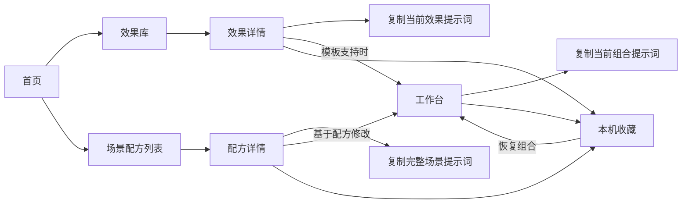

# UI 效果库：竞品研究与页面设计方案

日期：2026 年 10 月 26 日。面向海外与全球用户，首版提供英文和中文。

文档状态：页面与交互设计草案。颜色、字体、尺寸和动效参数是待验证的建议，尚未形成项目定稿的设计体系。

这份方案先确定产品的页面职责、布局与交互语言，再指导工程实现。技术与数据方案见 [架构与技术选型方案](/Users/peipei/mine/wanwan-Workspace/tomoyo-design/docs/architecture.md)，已确认需求见 [PRODUCT.md](/Users/peipei/mine/wanwan-Workspace/tomoyo-design/PRODUCT.md)。项目的 `app/`、`components/` 等目录全部位于根目录，不设置 `src/`。

本轮已经查看同类产品的实际页面并操作部分公开控件，证据见文末。下文的尺寸、颜色与动效时长是本产品的设计建议，尚需通过页面设计和实际运行验证。

## 1 研究结论与产品定位

产品定位为 **可以体验、调整并转成 AI 提示词的界面效果库**。核心用户不一定知道设计术语，也不一定能读代码。

| 参考产品与实际观察路径 | 值得采用的做法 | 对本产品的设计判断 |
|---|---|---|
| [React Bits](https://reactbits.dev/)：首页 → 组件目录 → Animated Content → Copy for AI 菜单 | 首页直接演示能力；目录以视觉卡片帮助查找；详情把预览、参数和 AI 导出放在同一条路径 | 首页需要真实体验；详情需要把提示词与当前参数联系起来。我们的操作区需要给不懂开发术语的人提供解释 |
| [Magic UI](https://magicui.design/)：首页 → Blur Fade 文档 | 首页大标题与主次入口清楚；组件文档的导航、预览、安装和用法层级明确 | 学习其排版与导航秩序。我们的首要交付物是可理解的提示词，因此复制提示词优先于安装指令 |
| [21st.dev](https://21st.dev/)：首页 → Community Components → Interactive Hover Button | 从视觉内容进入组件；组件详情把 Copy prompt 放在明显位置 | 复制应当是详情页直接可见的主要操作；效果可以被自然语言发现，不必先学会组件命名 |
| [Animista](https://animista.net/)：Basic → Scale Up → 调整时长 → 重播 → 生成代码 | 分类、变体、参数、实时画布和导出形成连续操作；改成 0.8 秒后生成代码也包含 0.8 秒 | 调参后应立即理解变化；导出的提示词必须包含当前配置。控件密度则需要降低，优先展示最有意义的参数 |

**复制给 AI 已经出现在同类产品中。** 我们的区别应体现在：把手册中的风格、材质、布局、配色和动效组织成容易理解的选择；帮助用户从单个效果走向完整场景；使预览和描述始终对应。仅增加一个复制按钮不足以形成清楚的产品价值。

设计上采用两层结构：网站本身提供稳定、清楚的操作环境；每个示例在自己的画布中呈现风格。用户切换玻璃、纸张或新粗野主义时，导航、表单和复制按钮保持统一，方便比较。

## 2 首页是什么

首页是产品的入口和一次简短的实际体验。它需要让首次访问者回答三个问题：这里有什么、我能拿走什么、下一步去哪里。

建议首页按以下顺序组织：

| 顺序 | 区块 | 内容与行为 |
|---|---|---|
| 1 | 全局导航 | Logo；效果库、场景配方、工作台；搜索、收藏、语言切换作为辅助入口 |
| 2 | 首屏说明 | 一句具体价值说明，例如“选择你喜欢的界面效果，把准确描述交给 AI。”主按钮“浏览效果库”，次按钮“体验一个场景”，后者定位到本页体验区 |
| 3 | 可操作的场景展示 | 同一张内容卡片提供 3 个视觉预设，保留相同文案和结构。切换后展示变化，并更新旁边的提示词摘要；提供复制和进入详情的入口 |
| 4 | 按类别发现 | 动效、风格、材质、布局、配色、节奏，各配一个能说明差异的小样例；点击进入效果库并带上分类 |
| 5 | 精选效果与场景 | 约 6 个精选效果、3 个场景配方；卡片展示真实内容，点击后进入对应详情 |
| 6 | 使用方法与页脚 | 选择参考 → 调整 → 复制给 AI；提供指南、语言、反馈与内容说明入口 |

桌面首屏将简短说明放在上部，场景体验占据主要视觉面积，用户无需滚动很久才看到效果。手机先给出价值说明和主入口，再展示同一个简化体验。

```text
┌──────────────── Logo · 效果库 · 场景配方 · 工作台 ────────────────┐
│                                                                │
│  价值说明                                  浏览效果库 / 体验场景  │
│                                                                │
│  ┌──────────────────────────────┬──────────────────────────┐   │
│  │                              │  预设选择                │   │
│  │       同一场景的真实预览       │  当前效果的提示词摘要      │   │
│  │                              │  复制提示词 / 查看详情    │   │
│  └──────────────────────────────┴──────────────────────────┘   │
│  类别入口 → 精选效果 → 场景配方 → 使用方法                       │
└────────────────────────────────────────────────────────────────┘
```

首页体验最终复用效果注册表、预览组件与提示词生成器。首屏展示哪个预设，就复制哪个预设的描述。首页最多保留一个持续运行的演示，其他卡片通过悬停、聚焦或主动播放触发。

## 3 导航与路由职责

下表使用 `/{locale}` 表示 `/en` 或 `/zh`。域名根路径 `/` 在托管层固定跳转到 `/en`；Logo 返回当前语言的首页。切换语言尽量停留在同一条内容上。

| 路由 | 用户在这里完成的任务 | 页面主要内容 | 主要出口 |
|---|---|---|---|
| `/{locale}` | 理解产品并开始体验 | 价值说明、可操作场景、分类入口、精选与使用方法 | 效果库；具体效果或配方 |
| `/{locale}/explore` | 找到某个独立效果，比较候选 | 搜索、分类、适用场景标签、视觉卡片 | 效果详情 |
| `/{locale}/effects/[slug]` | 体验和调整一个效果，取得描述 | 大预览、触发与重播、参数、说明、提示词、相关效果 | 复制；收藏；分享；适用时加入工作台 |
| `/{locale}/recipes` | 按目的寻找整体搭配 | 阅读、作品集、工具面板等场景卡片与筛选 | 配方详情 |
| `/{locale}/recipes/[slug]` | 理解并复用一个完整场景 | 场景预览、所用效果、关键参数、完整提示词 | 复制完整提示词；进入工作台修改 |
| `/{locale}/builder` | 在模板支持的范围内搭配自己的方案 | 模板选择、效果选项、实时场景、参数与完整提示词 | 复制；保存本机组合；分享或导出 |
| `/{locale}/saved` | 找回收藏与自己的组合 | 效果、配方、组合分组；清楚的本机保存说明 | 打开对应详情或恢复工作台 |
| `/{locale}/guide` | 学会使用和验证结果 | 提示词用法、术语解释、复现检查方法 | 示例详情；效果库 |
| `/preview/[id]` | 为宿主提供独立画布 | 只渲染已注册的可信示例，响应宿主参数 | 由宿主控制；不作为用户的导航目的地 |
| `/design-system` | 检查产品自己的设计与交互规范 | 颜色、排版、布局、控件状态、动效试验区 | 开发与评审使用；不放入主导航 |

搜索结果直接放在效果库中，例如 `/en/explore?q=hover&type=motion`；分类和筛选写入 query，便于返回和分享。经过修改的效果与组合参数按架构方案写入 URL fragment，恢复时进行校验。搜索和过滤不再增加一套页面。

指南首版可以是一页内容，使用页内目录；内容明显增长后再增加文章详情。效果库使用统一的分类筛选，不为每个分类重复实现一套列表。

独立预览与设计规范页不进入 sitemap，并设置不索引。设计规范页只放可公开的信息；导航隐藏和不索引不构成权限保护。



## 4 核心页面怎么布局

### 4.1 全站共享三种布局

| 布局 | 使用页面 | 空间组织 |
|---|---|---|
| 首页布局 | 首页 | 简洁顶栏、宽幅内容、清楚的纵向叙事；品牌与实际体验并重 |
| 列表布局 | 效果库、配方列表、本机收藏 | 顶栏、分类或分组栏、搜索筛选工具条、规则卡片网格 |
| 工作区布局 | 效果详情、配方详情、工作台 | 紧凑顶栏与面包屑、宽预览、右侧操作面板；说明和相关内容放在预览下方 |

指南使用阅读宽度受限的内容布局。三种主要布局共享同一套按钮、输入框、选中态和动效。首页也使用真实控件，让进入效果库后的体验自然衔接。

### 4.2 效果库

桌面左侧约 216px 放内容类型与必要的分类，中间保留足够宽度展示卡片。类别首先采用手册里的动效、风格、材质、布局、配色、节奏；“按钮、卡片、文字、背景”等适用对象作为第二层筛选。

卡片结构统一为 **固定比例预览 → 名称与类别 → 一句用途**。中英文术语可并列，说明尽量使用日常语言。收藏是辅助操作；点击卡片进入详情，卡片中的播放按钮只触发演示。

开始搜索时不清空现有画面；筛选保留可见的当前条件和“清除”入口。没有结果时展示搜索词、已选筛选以及清除筛选的按钮。首版内容少，可使用“推荐、名称”排序；没有可靠数据时不展示“热门”排名。

用户从详情返回时恢复 query 和滚动位置。目录默认展示预览封面，悬停或键盘聚焦时只播放当前卡片；触屏提供明确播放按钮。减少动态效果模式保留静态封面和主动播放入口。

### 4.3 效果详情

```text
┌────────────────────────── 公共顶栏 ─────────────────────────────┐
│  效果库 / 动效 / 悬停浮起                          收藏 · 分享    │
│  悬停浮起 · Hover lift                                         │
│  一句话解释用途                                               │
│  ┌────────────────────────────────────┬─────────────────────┐  │
│  │ 设备尺寸 · 背景 · 重播             │ 预设 / 重置         │  │
│  │                                    │ 距离、时长等参数    │  │
│  │             真实预览               │                     │  │
│  │                                    │ 提示词摘要          │  │
│  │ 触发方式说明                       │ 语言与技术要求      │  │
│  └────────────────────────────────────┤ 复制提示词          │  │
│  适用场景 / 工作原理 / 相关效果         └─────────────────────┘  │
└────────────────────────────────────────────────────────────────┘
```

预览占主要空间，操作面板建议宽 320–360px。面板优先展示 3–5 个有意义的参数，并提供预设和重置。参数需要单位和简短解释，例如“浮起距离：6px”，而不是直接暴露内部变量名。

复制按钮固定在操作面板的明显位置，与提示词语言、目标技术要求靠近。默认要求沿用用户项目的技术栈。完整提示词可展开检查，复制操作始终使用当前效果规范。

预览工具栏提供适用的重播、暂停、画布背景和设备尺寸切换。背景只改变画布环境；用于实现效果本身的背景值则属于效果参数，需要同步进入提示词。两者在控件文案上明确区分。

不要为单个效果强行展示全部能力。没有连续动画时无需暂停按钮；不能响应鼠标悬停的触屏设备提供可用的点击演示；仅有一组固定参数的示例可以直接使用预设。

### 4.4 场景配方与工作台

配方详情展示一个维护者已搭配好的场景，回答“它由什么组成、适用于哪里”。效果清单可以进入各自详情；主按钮复制整个场景，次按钮将同一配置带入工作台。

工作台在桌面上采用 **左侧方案结构、中间场景预览、右侧当前选项参数**。左侧依次安排模板、主风格、配色、布局、材质和动效。右侧随选中对象变化，不同时摊开所有选项。完整提示词通过固定入口展开，复制作用于整个当前方案。

初次进入工作台先展示一个可用模板和默认方案，允许切换模板。更换模板时检查已有选择是否兼容，并明确指出受影响的选项。列表中可用的组合需要经过实际验证。

进入详情不丢失工作台草稿；有外链配置时先校验版本和参数。恢复失败时说明原因并提供使用默认方案的入口。本机保存失败时仍能复制和导出当前方案。

## 5 产品自己的设计语言

推荐以 **清楚的编辑式排版、浅色中性操作区、大面积效果画布** 作为第一版设计基线。它需要同时容纳深色、彩色、纸张和玻璃等差异很大的样例。

以下数值用于制作高保真方案，之后根据真实内容调整，不直接视为已验收的设计。

| 维度 | 建议基线 | 用途 |
|---|---|---|
| 页面背景 | `#F7F8FA` | 保持内容区域清楚，减轻列表的视觉重量 |
| 面板表面 | `#FFFFFF` | 控件、参数区、弹层 |
| 主要文字 | `#17181C` | 标题、正文和关键参数 |
| 次要文字 | `#666A73` | 辅助说明；实际字号和背景组合需检查可读性 |
| 分隔线 | `#E4E6EB` | 组织面板和列表层次，避免大面积重阴影 |
| 强调色 | `#5B5CEB` | 主要操作、当前选项、焦点；使用前检查对应背景下的对比度 |
| 字体层级 | 正文 16/24；辅助 13/20；页面标题 32/40；首页标题桌面约 56/64、手机约 36/44 | 保持明确的阅读层级；中文使用合适的系统回退，参数数字可用等宽字体 |
| 间距 | 4、8、12、16、24、32、48、64px | 控件到页面使用同一套节奏 |
| 圆角 | 控件 10px；卡片 16px；主画布 20px | 区分操作控件和内容容器 |
| 阴影 | 主要用于悬浮菜单和短暂抬升 | 常规面板依靠表面色、边界与间距组织 |
| 图标 | 同一套线性图标与统一尺寸 | 高频功能保留文字；仅图标按钮提供可识别名称 |

网站首先完成一套完整的浅色主题。示例画布可以使用自己的深浅环境。整站深色主题如果进入首版范围，需要同等完整的状态验收，不能仅把背景反色。

shadcn/ui 作为控件基础，最终外观依照这里的设计语言调整。首页、效果库和工作台中相同的控件具有相同含义、尺寸和行为。

## 6 网站自身的动效规范

动效用于说明交互发生了什么、状态如何变化。以下均为建议值，不能从竞品截图推断出相同的时长或曲线。

| 场景 | 触发与表现 | 建议参数 | 减少动态效果时 |
|---|---|---|---|
| 按钮反馈 | 悬停改变表面色；按下轻微收缩，释放恢复 | 颜色 120–160ms；按压缩放约 0.98，100ms | 保留颜色和焦点反馈，取消缩放 |
| 内容卡片 | 悬停或聚焦时边界加深、轻微抬起 | 上移约 2px，160ms；阴影变化保持轻微 | 保留边界和选中状态，取消位移 |
| 标签切换 | 当前标签的强调位置变化，内容区轻微淡入 | 160–180ms；宽度和高度提前预留 | 即时切换或短淡入 |
| 下拉与抽屉 | 从所属控件附近进入；关闭回到原处 | 淡入配合约 8–16px 位移，180–220ms | 取消位移，直接显示 |
| 页面内容进入 | 进入页面时建立层级，不干扰导航和滚动 | 透明度与约 6px 位移，180–220ms | 即时显示；不强制过渡 |
| 首页首次进入 | 标题、说明、展示区依次出现一次 | 间隔约 50ms，总体控制在约 400ms 内 | 直接展示完整内容 |
| 复制反馈 | 按钮图标与文案改为成功状态，短暂保留后恢复 | 约 120ms；保持按钮宽度，使用状态播报 | 即时反馈 |
| 筛选结果变化 | 保留筛选栏，更新结果数和卡片内容 | 短淡入约 120ms；不让全部卡片大幅飞入 | 即时更新 |
| 预览重播 | 按照示例自身参数执行 | 与网站通用动效参数分开 | 说明动效已简化，保留用户主动播放选择 |

网站普通过渡优先使用统一的缓出曲线，例如 `cubic-bezier(0.2, 0.8, 0.2, 1)`。弹簧只用于确有必要的直接操作反馈；不要给所有菜单和页面都加入弹跳。

不增加人为等待来展示加载动画。加载时预留画布尺寸，必要时显示静态占位和明确状态；错误时给出重试或默认方案入口。页面滚动、键盘焦点和浏览器返回不受动画阻碍。

## 7 响应式与完整状态

| 宽度 | 布局策略 |
|---|---|
| 1280px 及以上 | 效果库显示分类侧栏；详情显示预览和 320–360px 操作面板；工作台可采用三栏 |
| 768–1279px | 次要导航收进抽屉；工作台改为预览与可切换面板；详情视可用宽度将参数放到预览下方 |
| 小于 768px | 单列；先看预览，参数按需展开；提示词可打开独立面板；底部保留复制入口并避开设备安全区 |

建议用 1440、1024、390px 三个视口验证设计，并检查 320px 的窄屏回退。断点根据真实内容宽度调整。长英文名称、中文文案和较长参数值都应在设计阶段进入样例。

每个通用控件检查默认、悬停、键盘聚焦、按下、选中、禁用状态；业务组件另补加载、空结果、错误、复制成功和复制失败。不能只设计理想状态。

复制失败时提供可选中的完整文本；无结果时提供清除筛选；收藏不可用时解释本机保存状态。弹层支持关闭、焦点约束和关闭后的焦点恢复。画布拥有可理解的名称和触发说明。

## 8 先做什么，做到什么程度

| 阶段 | 产出 | 验收重点 |
|---|---|---|
| 研究与信息架构 | 本文、实际界面截图、路由职责 | 能说明参考产品如何组织流程，以及我们的每个页面为什么存在 |
| 首页和详情页设计 | 桌面与手机的高保真方案、关键状态和动效说明 | 首页能证明产品能力；详情让用户清楚地体验、调整和复制；两页具有一致的设计语言 |
| 其他核心页面设计 | 效果库、配方和工作台布局 | 类别可发现；预览和操作空间充足；页面之间可顺畅衔接 |
| 网站布局与交互实现 | 根目录工程结构、公共导航、页面布局、通用控件、`/design-system` | 网站自身的排版、控件和动效经过实际操作验证 |
| 接通代表样例 | 4 个不同类型的样例及其提示词 | 参数、画面、提示词、分享恢复一致 |
| 扩充内容与上线验证 | 首版样例、场景和组合；必要的测试与检查 | 按架构文档的核心流程和性能标准验收 |

`/design-system` 是先做网站交互的检查场所：并排展示字体、颜色、按钮、输入框、标签、卡片、抽屉、复制反馈和过渡动画，提供减少动态效果的对照。它验证网站自身的质量，也为后续效果展示建立可复用基础。

下一项具体交付为 **首页和效果详情页的高保真设计**，用同一组真实内容验证品牌表达与使用效率；样例数量在这个基础上扩展。

## 9 实际页面观察与截图

以下均为 2026 年 10 月 26 日访问公开页面时保存并查看的截图。React Bits 和 Animista 主要使用 1440px 桌面视口；Magic UI 首页使用 1280px、详情使用 1440px；21st.dev 使用约 525px 的窄视口。因此对 21st.dev 的布局结论限于已观察到的窄屏状态。

本次研究覆盖页面层级、可见导航、公开预览与部分调参操作，没有进行性能测量、全流程无障碍审计、登录、付费或 AI 生成质量验证。截图记录某一时刻的界面，不能证明动画帧率或精确时长。

### 步骤 1：React Bits 首页与预设体验

[原页面](https://reactbits.dev/)。观察到介绍、主要入口和可交互背景展示组合在首页；实际切换过 Dune 预设，选中状态与显示的参数发生对应变化。留存截图是再次访问后的 Silk 预设状态。

判断：产品能力在进入目录前就能被体验。对我们的启发是把“预览与可导出的描述”一起放进首页体验，减少首次使用的解释成本。


### 步骤 2：React Bits 组件目录

[原页面](https://reactbits.dev/get-started/index)。左侧为组件导航与过滤，中间为视觉卡片网格，右侧有商业内容。

判断：发现路径清楚；在我们自己的目录中，应把可用宽度优先留给视觉比较和筛选，避免旁栏过多导致画布缩小。


### 步骤 3：React Bits 效果详情与 AI 菜单

[原页面](https://reactbits.dev/animations/animated-content)。实际打开 Copy for AI 菜单，看到提示词、当前配置代码、组件源码和安装指令等不同导出入口。页面同时提供预览、设备切换以及下方的参数区。

判断：预览到导出的路径完整。我们把提示词直接设为主按钮，技术性导出可以作为后续能力；本次没有验证复制内容或外部 AI 跳转。


### 步骤 4：Magic UI 首页

[原页面](https://magicui.design/)。浅色背景、大标题和两个主要入口形成清楚的介绍层级。

判断：首页的主要任务容易理解，适合参考其排版秩序。我们的首页还需要给用户一次可调整并取得提示词的体验。


### 步骤 5：Magic UI 组件详情

[原页面](https://magicui.design/docs/components/blur-fade)。左侧组件导航，中间预览和文档，右侧页内目录；安装、例子、用法与属性解释有明确层次。

判断：适合开发者查阅和安装。我们的说明应让不读代码的用户也能知道效果是什么、怎么触发、适用于哪里；此次未测试安装或外部工具功能。


### 步骤 6：21st.dev 首页

[原页面](https://21st.dev/)。首页强调借助 AI 使用现成设计，主要入口引导到产品和组件浏览。

判断：价值主张与复制复用的任务贴近。截图中展示区的复制状态属于网站自己的演示，不是本次研究完成了复制操作。


### 步骤 7：21st.dev 组件列表

[原页面](https://21st.dev/community/components)。窄视口中保留搜索、内容类型、类别入口和双列预览卡片。

判断：即使空间有限，发现入口仍然集中。我们需要验证长类别名和中英文内容在窄屏下的可读性，并允许筛选区收起。


### 步骤 8：21st.dev 组件详情

[原页面](https://21st.dev/@dillionverma/components/interactive-hover-button)。标题和作者信息之后，显眼的 Copy prompt 按钮紧靠大预览；下方有说明。

判断：复制入口的优先级清楚，适合我们的核心任务。此次只检查公开界面，未登录或验证复制与生成结果。


### 步骤 9：Animista 分类与参数画布

[原页面](https://animista.net/play/basic/scale-up/scale-up-center)。上方依次是类别、效果族与变体；左侧参数，中间预览，画布附近有重播与导出入口。

判断：参数与演示处于同一个工作环境，适合反复调整。多层分类和高密度选项也提示我们需要控制初次展示的参数数量。


### 步骤 10：Animista 调参、重播与生成代码

[原页面](https://animista.net/play/basic/scale-up/scale-up-center)。实际将 duration 改成 0.8 秒，触发重播并打开生成代码面板；页面可读内容中的 CSS 时长同步为 0.8 秒。截图记录面板打开时的画面，右侧代码区域仅部分可见。

判断：当前配置与导出结果之间的对应关系可确认。这是我们对“预览与提示词一致”的直接交互参考；未操作下载或复制到外部应用。


